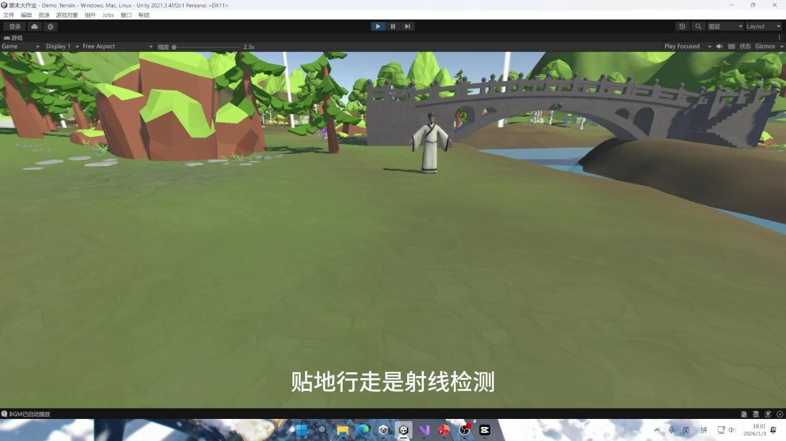

# 守桥人之约 — Zhaozhou Bridge 3D Game

An individual Unity coursework project about exploring Zhaozhou Bridge, collecting bridge components, answering knowledge questions and repairing parts of the bridge.

Author: Shenghao Ye. This was individual coursework, with AI assistance in code development. The scene uses third-party models and other assets.

[中文说明](README.zh-CN.md)

## Coursework preview

Screenshots were extracted from the original coursework demonstration, not from a new test of this repository. The editor interface, recording subtitles and taskbar have been retained.

- [Component collection and knowledge panel](docs/images/component-knowledge.jpg)
- [Knowledge quiz](docs/images/knowledge-quiz.jpg)
- [Bridge repair](docs/images/bridge-repair.jpg)
- [13-second repair demonstration](docs/media/bridge-repair-excerpt.mp4) — source interval 01:58–02:11, re-encoded without audio; original subtitles retained.

See [development notes](docs/DEVELOPMENT_NOTES.md) for the recorded workflow and [media provenance](docs/MEDIA_SOURCES.md) for the sources and limitations.

## Development work

The coursework development record describes scene assembly, conversion of the bridge model from C4D to FBX, model import, task/UI configuration and debugging of camera selection and Chinese font display. These were parts of completing the course project; the models themselves came from external resources.

## What this repository contains

**The complete Unity project is not publicly shared here because of copyright and redistribution restrictions on third-party assets used in the original project.** Public redistribution permission for all included models, audio, fonts and other assets has not been obtained.

This repository provides the four custom C# scripts and their Unity metadata, development notes, actual gameplay screenshots and a short demonstration excerpt. The original scene, third-party asset files, generated editor folders and builds are not included. It is a coursework showcase, **not a standalone playable Unity project**. Asset credits and licensing details are recorded in [THIRD_PARTY_ASSETS.md](docs/THIRD_PARTY_ASSETS.md).

## Original gameplay

1. Explore the 3D scene in first person and talk to the bridge keeper.
2. Collect three components and read their knowledge panels.
3. Answer three questions about bridge structure.
4. Click highlighted repair locations and complete the final conversation.

## Scripts

| Script | Responsibility |
| --- | --- |
| NoClipCamera.cs | Keyboard movement, mouse view, collision/ground checks, control locks |
| BridgePartCollection.cs | Trigger-based component collection, knowledge panels and progress |
| StoryController.cs | NPC dialogue, task progression, quiz UI, repair progress and sounds |
| ClickRepairDetector.cs | Raycast-based clicks on repair locations |

The filename NoClipCamera is retained from the coursework, although the script contains collision checks.

## Environment and integration

The original editor version was Unity 2021.3.45f2c1. Scripts use UnityEngine, Unity UI and TextMesh Pro. See [SCENE_SETUP.md](docs/SCENE_SETUP.md) for the required scene wiring and [environment notes](docs/ORIGINAL_ENVIRONMENT.md).

Importing only these scripts into an empty Unity project does not reproduce the original scene or gameplay. A compatible scene, colliders, layers, UI elements and Inspector references must be set up first.

## Assets and licensing

The development document identifies the nature environment as Pure Poly's Free Low Poly Nature Forest from the Unity Asset Store, and the bridge model, elder NPC model and audio as resources from Aigei / 爱给网. Other original files include textures and Chinese fonts. These original asset files have been left out because permission to redistribute them publicly was not established. Recorded source credits and remaining details are listed in [THIRD_PARTY_ASSETS.md](docs/THIRD_PARTY_ASSETS.md).

No project-wide open-source license has been selected. This repository does not grant rights to excluded assets.

## Verification and limitations

The source files and task flow were inspected, and script metadata was retained. No Unity build or runtime gameplay test has been performed on this prepared showcase. No learning-effect, performance or research results are claimed.

The original coursework recording provides historical evidence of the collection, quiz and repair interactions. It does not establish that the prepared script-only repository runs independently, or that all original bugs were resolved. The scripts alone do not demonstrate that every scene reference was correctly wired.

## Coursework and AI assistance

Course: 动画设计与制作. During repository preparation, Chinese comments were converted from the original GB18030 encoding to UTF-8; script logic was preserved.
